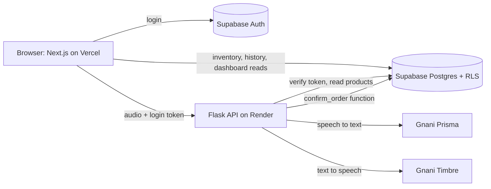

# Voxora

**Your Voice. Your Store. Smarter Commerce.**

Voxora is a voice ordering and inventory app for small Indian grocery (kirana) stores. A shopkeeper presses a mic button and speaks a customer's order in English, Telugu or Kannada, including mixed-language speech such as *"Anna, rendu kilo biyyam, oka litre oil, moodu packet milk kavali"*. Voxora turns the speech into a checked order and a bill, reads the order back aloud, and only saves it when the shopkeeper confirms.

Built for the **Gnani AI Great Indian Internship Challenge 2026**.

- Live app: `<https://voxora-lyart.vercel.app/>`
- Backend health check: https://voxora-ttfr.onrender.com/api/health
- Demo video: `<->`

## How Gnani AI is used

| Gnani model | Used for | Where in the code |
|---|---|---|
| **Prisma** (speech-to-text) | Converts the recorded order into text | `backend/app/services/gnani_prisma.py` |
| **Timbre** (text-to-speech) | Reads the order and total back to the shopkeeper | `backend/app/services/gnani_timbre.py` |

**Prisma details.** The browser records audio and converts it to 16 kHz mono WAV, because the browser's default WebM format is not accepted by the API. The backend sends it to `POST https://api.vachana.ai/stt/v3` with `model=prisma-v3.0` and `format=transcribe`. We compared the `codemix`, `transcribe`, `verbatim` and `transliterate` output styles on real recordings. `transcribe` was the best fit, because it returns quantities as digits (`2 kg`, `1 litre`) and keeps English words in Latin letters. The shopkeeper can pick English, Telugu, Kannada or auto-detect, which sets the language hint (`en-IN`, `te-IN,en-IN`, `kn-IN,en-IN`, or `indic-auto`).

**Timbre details.** The backend sends text to `POST https://api.vachana.ai/api/v1/tts/inference` with `model=timbre-v3.0` and the `Shivani` voice, in `en-IN`, `te-IN` or `kn-IN`. Numbers are converted to words before synthesis, as the Gnani docs recommend. The spoken sentence is built on the server from the checked order, never from text sent by the browser.

The Gnani API key lives only on the Flask server. It is never sent to the browser or stored in the repo.

## Features

- **Voice orders.** Record, transcribe, and review the order in an editable table before anything is saved.
- **Deterministic order parsing.** Products and quantities are matched against the store's inventory using an editable alias dictionary (English, Telugu and Kannada names), with fuzzy matching for spelling variations. Units such as kg, g, litre, ml and packet are normalised, and grams or millilitres convert to kg or litres.
- **No silent guessing.** Unknown products, missing quantities, unclear units, ambiguous names and insufficient stock are each flagged on the row. The order cannot be confirmed until every row is OK.
- **Backend billing.** AI never calculates money. Prices come from the database, and totals use decimal arithmetic.
- **Spoken confirmation.** Timbre reads the order and total in English, Telugu or Kannada, with the text shown next to the audio and a replay button.
- **Safe order confirmation.** One database transaction saves the order, locks the product rows, checks stock and deducts it. An idempotency key means a double click cannot create two orders or deduct stock twice.
- **Inventory management.** Add, edit and delete products, update prices and stock, search by name or alias, filter by category, and see low-stock products highlighted.
- **Order history.** Search, date filter, order details, and a printable invoice (print or save as PDF). Orders keep the product name and price from the time of sale.
- **Dashboard.** Sales and orders today, product count, low-stock list, a 7-day sales chart and recent orders.
- **Accounts.** Email and password login. Each shopkeeper sees only their own store, enforced with Supabase row-level security.

## Architecture



Voice, parsing, billing validation, spoken confirmation and order confirmation all go through the Flask API. Plain reads and product edits go from the browser straight to Supabase, protected by row-level security.

## Tech stack

- **Frontend:** Next.js (App Router), React, TypeScript, Tailwind CSS, Lucide icons
- **Backend:** Python, Flask, gunicorn
- **Database and auth:** Supabase (PostgreSQL, Auth, row-level security)
- **Voice:** Gnani Prisma and Timbre
- **Hosting:** Vercel (frontend), Render (backend), Supabase (database)

## Project structure

```
voxora/
├─ backend/
│  ├─ run.py
│  ├─ requirements.txt
│  ├─ .env.example
│  ├─ app/
│  │  ├─ __init__.py
│  │  ├─ config.py
│  │  ├─ routes/        health, me, voice, orders
│  │  ├─ services/      gnani_prisma, gnani_timbre, order_parser, billing_service,
│  │  │                 inventory_service, spoken_text
│  │  └─ utils/         auth, errors
│  └─ tests/            order parser and spoken text tests
├─ frontend/
│  ├─ app/              login, register, (app)/dashboard, voice-orders, inventory, orders
│  ├─ components/       AppShell, ConfirmOrder, SpokenConfirmation
│  ├─ lib/              api, supabase, wav
│  └─ .env.local.example
├─ scripts/test_gnani.py   test Prisma and Timbre directly
└─ supabase/schema.sql     database schema, security policies and functions
```

## Run it locally

You need Node 18.18 or newer, Python 3.10 or newer, a Supabase project and a Gnani API key.

### 1. Database

1. Create a project at https://supabase.com.
2. Open **SQL Editor**, paste the contents of `supabase/schema.sql` and run it.
3. Open **Authentication > Providers > Email** and turn **Confirm email** off for local testing.

### 2. Backend

```bash
cd backend
python -m venv .venv
# Windows PowerShell: .venv\Scripts\Activate.ps1
# Mac or Linux:       source .venv/bin/activate
pip install -r requirements.txt
cp .env.example .env        # Windows PowerShell: Copy-Item .env.example .env
```

Fill in `backend/.env`:

| Variable | Value |
|---|---|
| `GNANI_API_KEY` | Your key from https://app.gnani.ai |
| `GNANI_STT_URL` | `https://api.vachana.ai/stt/v3` |
| `GNANI_TTS_URL` | `https://api.vachana.ai/api/v1/tts/inference` |
| `FRONTEND_ORIGIN` | `http://localhost:3000`. For several addresses, separate them with commas. |
| `SUPABASE_URL` | Your Supabase project URL |
| `SUPABASE_SERVICE_ROLE_KEY` | Your service-role key. Keep it secret and server-side only. |

```bash
python run.py
```

The API runs on http://127.0.0.1:5001. Check http://127.0.0.1:5001/api/health.

### 3. Frontend

```bash
cd frontend
npm install
cp .env.local.example .env.local     # Windows PowerShell: Copy-Item .env.local.example .env.local
```

Fill in `frontend/.env.local`:

| Variable | Value |
|---|---|
| `NEXT_PUBLIC_API_URL` | `http://localhost:5001` |
| `NEXT_PUBLIC_SUPABASE_URL` | Your Supabase project URL |
| `NEXT_PUBLIC_SUPABASE_ANON_KEY` | Your anon (publishable) key. Never use the service-role key here. |

```bash
npm run dev
```

Open http://localhost:3000, create an account, and a store with six sample products is created for you. The browser only allows microphone access on `localhost` or HTTPS.

## Tests

Parser, billing and spoken-text tests (no network or database needed):

```bash
cd backend
python -m unittest discover -s tests -t . -v
```

They cover English, Telugu-mixed and Kannada-mixed orders, missing quantities, unknown products, insufficient stock (including the same product named twice), unit conversion, ambiguous aliases, decimal money, and the spoken confirmation text in all three languages.

To test the Gnani APIs directly, put a short WAV file in a `samples` folder and run:

```bash
cd backend
python ../scripts/test_gnani.py stt ../samples/english.wav en
python ../scripts/test_gnani.py tts
```

The speech and ordering flow was also tested by hand on real recordings in English, Telugu and Telugu-English mixed speech. Kannada transcription was tested through the Prisma API on a recorded clip.

## Deployment

**Backend on Render** (Web Service)

| Setting | Value |
|---|---|
| Root directory | `backend` |
| Build command | `pip install -r requirements.txt` |
| Start command | `gunicorn run:app --bind 0.0.0.0:$PORT --workers 2 --timeout 120` |
| Environment | The six variables from the backend table, plus `PYTHON_VERSION=3.12.3` |

Set `FRONTEND_ORIGIN` to your Vercel address (and `http://localhost:3000` if you also want local access), separated by a comma, with no trailing slash.

**Frontend on Vercel**

Set the root directory to `frontend` and add the three `NEXT_PUBLIC_` variables. `NEXT_PUBLIC_API_URL` is your Render address. After deploying, set your Vercel address as the **Site URL** in Supabase under **Authentication > URL Configuration**.

The free Render tier sleeps after 15 minutes of inactivity, so the first request after a pause can take up to a minute.

## Security notes

- API keys are read from environment variables on the server. `.env` files are git-ignored, and only `.env.example` files are committed.
- The Flask API checks every request's Supabase login token and finds the caller's store itself, so a request cannot name another store.
- Row-level security limits the browser to the shopkeeper's own store. Orders, order items and voice logs are read-only from the browser and are written only by the backend.
- `confirm_order` re-reads prices and stock from the database, so a tampered browser request cannot change a price or oversell stock.
- Audio is processed in memory and sent to Gnani for transcription. It is not stored by Voxora.

## Known limitations

- Recognition quality depends on the recording. Unusual product names or heavy background noise can produce a wrong transcript, which is why every order is reviewed and editable before it is saved.
- Product matching only knows the names in the alias lists. When a word is missed, the shopkeeper adds it to the product's aliases on the Inventory page. The starter products come with English, Telugu and Kannada names.
- Recordings are limited to about 28 seconds, because the speech API accepts up to 30 seconds.
- Orders cannot be edited or cancelled after confirmation yet. The database supports discounts, but there is no discount field in the interface yet.
- There is no dedicated analytics page. The dashboard covers today's sales, a 7-day chart, low stock and recent orders.
- Only the Gnani models listed above are used. Evon was not integrated.

## Roadmap

- Order cancellation with stock restore
- Discounts in the order screen
- Analytics page with weekly and monthly revenue and best-selling products
- Tamil and other languages that Prisma and Timbre support
- Hands-free mode that confirms the order by voice

## Author

Built by Karthik Jayanthi.
